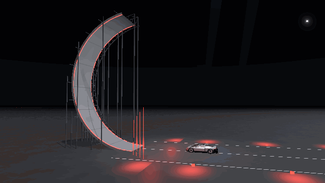

# Flying Tesla

> **Unofficial educational simulation. Not affiliated with Tesla or SpaceX.**

**▶ [Open the live 3D explainer](https://eduardmur.github.io/flying-tesla/)** · [Read it without 3D](https://eduardmur.github.io/flying-tesla/how-it-works/) · [How the physics works](docs/PHYSICS.md)

[](https://github.com/eduardmur/flying-tesla/actions/workflows/ci.yml)
[](LICENSE)
[](LICENSE-CONTENT.md)



On 15 Oct 2026 a roadster drove up a ramp that curled over until it was upside down, hung there,
dropped off the end, rolled half a turn in mid-air and landed on its wheels. This browser
experience lets you **feel how that works**. Underbody fans suck the car onto the road, then
compressed-air thrusters push it. Every number on screen says whether it was **reported** or is our
**estimate**, and links to its source.

## What you can do

- **Take the tour.** Six short chapters with a hands-on task in each: the grip ceiling, sucked to
  the road (tilt the road until the car hangs from a ceiling), a tank of air, how a nozzle makes
  thrust, the hop, and the limits. About 6 minutes.
- **Drive it.** Pick Performance, Thrust or Rocket; the hardware appears and disappears on the car.
  The challenges have medals and personal bests:
  - Drag strip: 0–60 against the claimed times.
  - **The Curl**: the reveal trick on the reported 170°, ~21 m ramp. Watch the autopilot first, then
    try it yourself against its ghost. With the default assists you only hold W and steer; turn them
    off for hard mode.
  - Car hop over parked cars, with a bonus for a kick flip.
  - Hover hold: stay 2 m up for as long as the air lasts.
  - Free roam, including a tube to drive on walls and the ceiling.
- **Look inside.** X-ray and an exploded view, with clickable parts. Lab panels cover grip, tanks
  (pressure and temperature graphs), the nozzle (Mach number along it), underbody pressure and
  refill energy. You can also slow time to 0.1× and scrub back 10 seconds, even mid-air.
- **"What if"** sliders, clearly marked as fiction: tank pressure, volume, mass, fan power, gravity
  (Earth, Moon or Mars) and ambient pressure.

## Controls

| Key                                                       | Action                             |
| --------------------------------------------------------- | ---------------------------------- |
| <kbd>W</kbd><kbd>A</kbd><kbd>S</kbd><kbd>D</kbd> / arrows | Drive · in the air: pitch and roll |
| <kbd>Space</kbd>                                          | Rear thrusters                     |
| <kbd>Shift</kbd>                                          | Lift (Rocket)                      |
| <kbd>Q</kbd> / <kbd>E</kbd>                               | Yaw nozzles (Rocket)               |
| <kbd>R</kbd>                                              | Roll 180° assist                   |
| <kbd>F</kbd>                                              | Fans on/off                        |
| <kbd>X</kbd> · <kbd>L</kbd>                               | X-ray · lab panels                 |
| <kbd>P</kbd> · <kbd>C</kbd> · <kbd>T</kbd> · <kbd>H</kbd> | Pause · camera · restart · hide UI |

Gamepads are supported (triggers drive, A thrust, RB lift, Y roll). Phones get a virtual stick and
big thrust/lift buttons.

## The physics in brief

- **Tires cap acceleration at μ·g.** The reported tire-only grip is about 1.26 g. On tires alone, our
  model needs 2.2 s to reach 60 mph however much motor power you add.
- **Suction raises the cap.** The reported downforce readout is 4,700 kg (≈ 46 kN) over a ~4 m²
  sealed floor (estimate). That needs only **≈ 11.5 kPa**, about 11 % below ambient pressure. Leakage
  under the skirts grows fast with the gap, so suction collapses within a fraction of a second when
  the car leaves the lip of the curl.
- **Thrust bypasses the tires.** Air stored at 5,500 psi (reported in-car readout) leaves four
  choked, under-expanded nozzles at about Mach 3.7. Calibrated to the reported 80 kN, they use
  ≈ 117 kg/s at ≈ 680 m/s, so 250 kg of air lasts about **2 s** of full thrust. That matches
  CellCog's independent estimate.
- **Blowdown.** As the tank empties, the remaining gas cools (adiabatic, isothermal or blended model),
  pressure falls, and thrust falls with it.
- **Flight computer.** A rate controller with auto-level, a roll-180 assist and a "suicide burn"
  landing profile mixes four lift nozzles and two yaw nozzles.

The validation tests (`tests/physics`) check the model against every reported number: 80 kN ±2 %,
blowdown time, ~23 kN to hover, ~35 kWh to refill, and 0–60 for each trim within −15 %/+0 % of the
claim. Full notes: [docs/PHYSICS.md](docs/PHYSICS.md).

## Confirmed vs estimated

Figures come from public reporting as of **16 Oct 2026**. Every number lives in
[`src/data/specs.ts`](src/data/specs.ts) as `reported` (with a source), `estimate` (our assumption
or calibration) or `confirmed` (textbook constants). In the app, open **More → What's confirmed vs
estimated**. Sources: [docs/SOURCES.md](docs/SOURCES.md). Modelling choices: [docs/DECISIONS.md](docs/DECISIONS.md).
Found a better source? [Open a spec correction](../../issues/new?template=spec-correction.yml).

## Run it locally

```bash
npm install
npm run dev        # http://localhost:5173/flying-tesla/
npm test           # physics + headless sim tests
npm run build
npm run e2e        # Playwright smoke test (builds must exist; starts a preview server)
```

Stack: Vite, TypeScript (strict), React, three.js via react-three-fiber and drei, Rapier for rigid
bodies, Zustand, and synthesised WebAudio. The car, sky, ground and sounds are all generated in
code; there are no third-party assets. See [CREDITS.md](CREDITS.md).

```
src/physics/  pure, tested physics (gas, tank, nozzle, suction, tires, flight computer, launch)
src/sim/      Rapier world, raycast vehicle, forces, recorder, autopilot, challenges
src/scene/    car, environment, effects, cameras
src/ui/       HUD, lab, tour, challenges, controls
src/data/     specs.ts · sources.ts · tour.ts · components.ts
```

No analytics, no trackers. Best times stay in your browser.

## Licence

Code: [MIT](LICENSE). Written explainer content (tour captions, part cards, `/how-it-works`, docs):
[CC BY 4.0](LICENSE-CONTENT.md). Contributions welcome: see [CONTRIBUTING.md](CONTRIBUTING.md) and
the [Code of Conduct](CODE_OF_CONDUCT.md).

Unofficial educational project. Not affiliated with, endorsed by, or connected to Tesla, Inc. or
SpaceX. "Tesla" and "Roadster" are trademarks of Tesla, Inc., used here only to identify the
subject. Figures come from public reporting as of 16 Oct 2026; estimates are marked.
